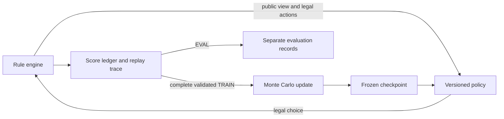

# Magical Athlete Strategy Lab

A reproducible simulation and Monte Carlo learning environment for studying strategy in a stochastic multiplayer board game. The implementation separates game rules, public-information decisions, score accounting, and experiment records so that individual outcomes and learning updates can be inspected and replayed.

This is an unofficial research implementation of the original-box **Magical Athlete**: four players, a two-round draft, and four races in **Mild / Wild / Mild / Wild** order.

## Research question

Can first-visit Monte Carlo control with Thompson sampling improve expected cumulative score across drafting, race-entry selection, and legal in-race decisions? The current work establishes a rule-based simulator and an auditable experimental pipeline, then examines a fixed training increment against several opponent configurations. It has not yet established a reliable playing-strength improvement.

## Research snapshot — 2026-11-02

This repository includes complete-game simulation, deterministic replay, **1,336 portable tests**, a small Model A learning example, and compact evaluation-score exports. The source and examples are publicly available here. Historical model weights, large experiment databases, and full research replay collections remain local.

The selected research checkpoint contains **1,024 complete training Games across eight updates**, preserving the earlier 896-Game parent. Re-executing its recorded training history under the current engine reconstructed the same checkpoint bytes; this checks data and update consistency, not playing strength. **A statistically reliable performance improvement has not been established.** The included small learning example starts from an empty prior and does not require the historical checkpoint.

A later predeclared continuation stopped at its initial developer-evaluation gate after an event-budget diagnostic and produced **zero new training Games or updates**. The retained failure and unstarted coordinates are reported separately from the completed comparisons. See [known limitations](#known-limitations-and-next-work) and the [comparison protocol](docs/CHECKPOINT_COMPARISON.md).

## Quick start

Use Python **3.12+**; the demonstrated environment is Python 3.12.15. Open a terminal in the cloned or downloaded repository root. Create a virtual environment:

```console
python -m venv .venv
```

Activate it with `.venv\Scripts\Activate.ps1` in Windows PowerShell or `source .venv/bin/activate` on macOS/Linux. If PowerShell blocks activation, use `.venv\Scripts\python.exe` in place of `python` in the following commands. Windows is the verified platform; other platforms have not been independently validated.

Install and run:

```console
python -m pip install -e ".[test]"
python -m magical_athlete.demo --seed 1 --output demo-output
python -m magical_athlete.demo --replay demo-output/trace.json
```

The installed `magical-athlete-demo` command exposes the same interface. Runtime simulation uses only the Python standard library; pytest is a test dependency. No experiment database, pretrained checkpoint, or network service is needed to run the demo.

Use a **new output directory** for another run. Existing evidence is never overwritten.

For seed `1`, the verified final scores for players `0, 1, 2, 3` are:

| Player | Four-race total |
| --- | ---: |
| 0 | 12 |
| 1 | 10 |
| 2 | 10 |
| 3 | 3 |

Player `0` wins. This is a reproducibility example, not a strategy-performance result. See the small [expected result](examples/demo-seed-1.expected.json).

The command writes:

- `summary.json`: the four race results and the complete point ledger, separated into placement chips, Stars, and skill gains or penalties.
- `trace.json`: draft choices, entries, dice, legal public decisions, events, and final scores.

Every successful demo is checked by strict replay of each race and the full game. Replaying requires matching engine code. Diagnostic budget failures are retained as incomplete evidence and return a nonzero exit code; they are not converted into invented finishes.

## Optional: a real Model A update

```console
python examples/model_a_smoke.py --output smoke-output
```

This independently starts from an empty prior and saves **4 training games + 8 frozen evaluation games**, with **one real model update**. All twelve games and the update evidence are retained in the new local output directory. A verified run took about 34 seconds on the development machine; runtime varies.

The example demonstrates persistence, learning-data isolation, and changed action estimates. Twelve games are too few to establish playing strength. It does not load or extend the historical research checkpoints. See the [small recorded summary](examples/model-a-smoke.summary.json) and [example instructions](examples/README.md).

## Methods and architecture

- **Rule engine:** explicit event ordering and legal decision windows; policies receive public observations rather than future dice, hidden choices, or random-generator state.
- **Complete-game simulation:** draft, simultaneous entry selection, one use per character card, four races, and shared winners when final scores tie.
- **Score ledger:** the objective includes placement awards, Stars, and actual skill bonuses and deductions; it is not a win/loss reward or a fixed score pool.
- **Model A:** first-visit Monte Carlo control with a Dirichlet–Categorical score posterior and Thompson sampling. The optimization target is expected official four-race total score, `E[S_total]`. Each focal decision learns the final total minus the score already accrued; negative remaining returns are retained.
- **Experiment records:** versioned policies, separate training/evaluation purposes, retained failures, and persisted complete games before updates. Mean evaluation has its own explicit repetition-guard version.

The implementation contains the original 36 racer abilities and project-specific edge rulings. Coverage is finite; this is not a claim that every possible interaction has been proved correct.



Evaluation records do not feed model updates. Diagnostic failures remain available for debugging.

## Observed results

The frozen 896- and 1,024-Game checkpoints use the same mean-inference configuration, including a 0.05 exploration floor. Each row has **128 paired Game seeds**, balanced across four focal seats. The target is official four-Race total score; intervals use 2,000 paired-Game bootstrap replicates within seats.

| Opponents | Study | Mean difference, 1,024 minus 896 | Pointwise 95% interval |
| --- | --- | ---: | --- |
| Three frozen prior Model A policies | Fresh post-repair native study | −0.0078125 | [−0.546875, 0.500000] |
| Three uniform random policies | Initial exploratory panel | −0.2500000 | [−0.875000, 0.359375] |
| Three public-history first-legal policies | Initial exploratory panel | +0.1953125 | [−0.2578125, 0.656250] |

All intervals include zero. These conditions are reported separately; the table does not establish stronger play or generalization to arbitrary opponents. The original native panel stopped after one retained diagnostic and left its other arm unstarted. A focused repair, new-source certification, and a separately predeclared native study followed. The old failure remains in the original coverage; the 512 completed exploratory Games matched strict replay under the repaired engine and are counted once.

Recompute statistics and attempt coverage from the supplied score exports using only the standard library:

```console
python examples/checkpoint_comparison/paired_scores_with_coverage.py --input examples/checkpoint_comparison/paired-scores-with-coverage.json
python examples/native_postrepair/native_postrepair_scores.py --input examples/native_postrepair/native-scores-with-coverage.json
```

These commands reproduce the supplied statistics, not the full historical training archive. See the [comparison protocol and limitations](docs/CHECKPOINT_COMPARISON.md).

The [stopped continuation's coverage export](examples/fixed512_stopped/README.md) retains all 768 planned statuses, including the diagnostic and 640 unstarted Games. Its report has no after-model or confidence interval:

```console
python examples/fixed512_stopped/fixed512_development_scores.py --input examples/fixed512_stopped/fixed512-development-scores.json
```

## Tests and validation

From the repository root, run:

```console
python -m pytest -q
```

The published source passed **1,336 portable tests**, including all **33 curated real-engine scenarios**, in a separate, freshly installed Python 3.12.15 environment on Windows. Installation, imports outside the source directory, the console entry point, the seed-1 full-Game replay, and score-statistics recomputation were also verified. These are finite checks, not an exhaustive proof of all rule interactions. Additional historical and archive-dependent research tests are outside the portable suite. See [validation notes](docs/VALIDATION.md) for the executed checks and their provenance.

## Known limitations and next work

Complex skill chains can still exhaust diagnostic budgets. The earlier identified native forced-cycle case now completes under a narrowly scoped, independently reviewed repair. All **1,024 historical training Games**, the **512 completed exploratory Games**, and the **256 new native evaluation Games** passed their respective execution or replay checks under the repaired source. A later developer-evaluation seed exposed a different unresolved chain involving Suckerfish, Scoocher, Huge Baby, and Flip Flop. It reached the event budget; this alone does not prove an infinite loop. The continuation stopped with that diagnostic retained and no new update. These finite checks do not prove that every possible interaction terminates correctly. Failures are reported as incomplete rather than assigned invented outcomes.

The later continuation retained **127 complete initial developer-EVAL Games and one diagnostic**. Its **512 planned TRAIN Games and 128 final developer-EVAL Games were unstarted**. No new samples were consumed, no update was committed, and no 1,536-Game checkpoint or before/after score interval exists. Its parameters and stop conditions were fixed before the latest native score difference was disclosed. Failed Games are not silently replaced or included in learning.

The next engineering task is to investigate that fixed diagnostic before resuming training. Further research would examine state-grouping sparsity, sample efficiency, and transfer to additional frozen opponents. Model B, formal character rankings, Second Wind, other player counts, and a web interface are outside the current scope; no optimality or equilibrium claim is made.

## Repository scope

`src/` contains the implementation, `tests/` the portable suite, `examples/` the small reproducibility examples and score exports, and `docs/` the methods and validation reports. Local environments, large experiment stores, full replay collections, historical weights, and original third-party rulebooks or artwork are not included in this repository. The test metadata contains only the rule-version identifier and curated test IDs.

The public examples reproduce a complete Game, a small learning update, and the supplied score-statistics calculations. They do not reconstruct the unavailable historical weights or independently authenticate the full private research archive.

See [repository scope](docs/RELEASE_SCOPE.md) for the inclusion boundary. This is an unofficial implementation. Original third-party PDFs, scans, and artwork are not distributed here. No project license has been selected.
